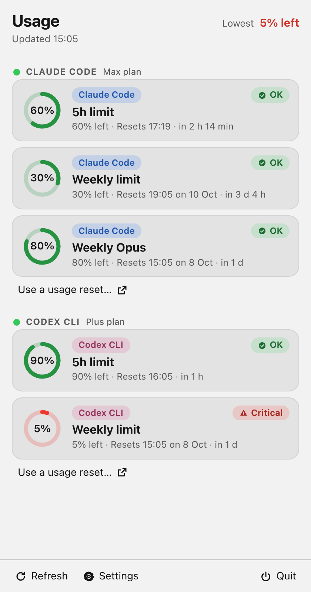
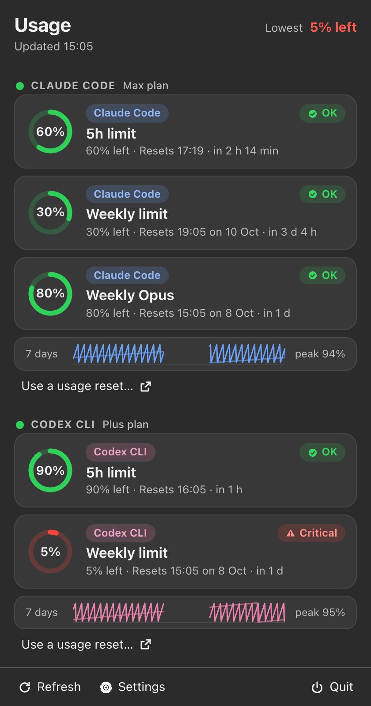

# Usage Bar (cross-platform)

A tray / menu-bar app for Windows, Linux and macOS that shows how much of your **Claude Code** and **Codex** usage limits
you have used: the 5-hour window, the weekly window, weekly Opus and so on, with threshold alerts, a reset countdown and a
7-day history. Built with Tauri 2 (Rust) and a Preact page. It is a separate app with its own tray icon; it uses the same
file and key names as the Mac usage bar from CLI-Usage for `settings.json`, `usage-alerts.json` and `usage-history.json`.

Screenshots use made-up sample numbers (light, then dark with the 7-day history):

| Light | Dark |
|---|---|
|  |  |

> **Read this before installing.** Usage Bar reads the sign-in token that the Claude Code CLI (`~/.claude/.credentials.json`) and the Codex CLI (`~/.codex/auth.json`) already keep on your computer, read-only. It sends that token only to the provider that issued it (`api.anthropic.com` for Claude, `chatgpt.com` for Codex), over HTTPS, to ask how much of your limit is used. Nothing is sent to the author or any third party: no analytics, no account, no telemetry. The tokens are never written, copied or logged, and the app's web view has no network access.
>
> The two endpoints (`/api/oauth/usage` and `/backend-api/wham/usage`) are **undocumented and unofficial**. They can change or stop working at any time. Using CLI tokens with an unofficial endpoint may be outside what Anthropic's or OpenAI's terms allow. You use this app at your own risk, and the author is not responsible for any action a provider takes on your account. If in doubt, do not use it.
>
> Usage Bar is an independent project. It is not affiliated with, endorsed by or sponsored by Anthropic or OpenAI. Claude, Claude Code, Codex, ChatGPT and OpenAI are trademarks of their respective owners.

**Status: early (v0.1.0).** Tested on macOS with fake servers only. Windows and Linux are untested, and the real Claude and Codex endpoints have not been called by the author. On a Mac, Claude Code usually keeps its token in the Keychain, which this app does not read, so Claude usage will not show there.

This project is based on [CLI-Usage](https://github.com/nimaansari/CLI-Usage) by Nima Ansari (MIT). The Tauri, Rust and Preact code here is a separate implementation written from the Mac bar's behaviour and tests; see Credit below.

## What it does

- Provider cards: ring, `N% left`, `Resets 17:19 · in 2 h 14 min`, an OK / Low / Critical chip, header `Lowest N% left`.
- Tray text `63% left` (always "left", so it cannot be read as used) next to the icon on macOS; a tooltip on every OS.
- Alerts when a limit crosses 80% and 95% used (both adjustable 50 to 99): once per provider + limit + reset window, re-armed
  when usage falls 5 points, never for a provider whose refresh just failed, only counted as sent after the OS accepted the
  notification (3 retries, saved across restarts), more than 3 at once become one notification.
- 7-day sparkline per provider (a sample at most every 10 minutes, 1,100 samples per limit, 64 series, gaps over 2 h drawn as gaps).
- Settings: rows shown, alerts on/off and thresholds, history on/off, appearance, colour theme, layout (Cards, Glass, Solid,
  Compact), start at login. Light and dark. Keyboard and screen-reader friendly, right-to-left safe, works at small heights.
- Refresh every 60 s (+-10% jitter). A provider that fails is retried after 120 / 240 / 480 / 600 s, on its own: a dead
  provider never slows down the healthy one. That backoff is saved (`usage-backoff.json`, absolute times, never more than 10 minutes ahead after a clock change), so a restart does not reset it. The Refresh button waits 10 s between clicks; after the computer wakes the two providers are fetched 5 to 15 s apart. The last good numbers stay on screen, marked "couldn't refresh".

## How the usage numbers are obtained (read this)

Neither provider documents a public usage API for subscription limits. This app uses the same sign-in tokens that the
Claude Code and Codex command-line tools store on your computer, and asks two endpoints that those tools' accounts are
accepted by today. **I know these endpoints from public behaviour (community tools and the CLIs' own traffic), not from
official documentation, and I could not test them against the real services from this build** (see "Verified" below). They can
change or stop working without notice.

| Provider | Source | Certainty |
| --- | --- | --- |
| Claude | `GET https://api.anthropic.com/api/oauth/usage` with `Authorization: Bearer <Claude Code OAuth token>` and `anthropic-beta: oauth-2025-04-20`. Response: windows such as `five_hour`, `seven_day`, `seven_day_opus`, each `{utilization: percent used, resets_at}`. | Medium. Endpoint and header are widely used by third-party tools; field names match the response shapes in the Mac bar's tests. Not officially documented. |
| Codex | `GET https://chatgpt.com/backend-api/wham/usage` with `Authorization: Bearer <Codex ChatGPT token>` and `ChatGPT-Account-Id`. Response: `rate_limit.primary_window` / `secondary_window` (`used_percent`, `limit_window_seconds`, `reset_at`), optional `additional_rate_limits`. | Medium to low. Same status. |
| Codex fallback | Runs `codex app-server` (fixed arguments, no shell, killed after 10 s) and calls `account/rateLimits/read`. Reply shape `{rateLimits: {planType, primary: {usedPercent, resetsAt}, secondary}}` is the one in the Mac bar's tests. | Medium for the reply shape, low for the exact request names (initialize / initialized / account/rateLimits/read are from my knowledge of the Codex app-server protocol). |

Because the shapes are uncertain, parsing is deliberately tolerant (strings, NaN, booleans, negatives, over 100, missing
fields, epoch seconds or milliseconds or ISO times with any number of fraction digits). A response with no readable limit is
shown as `usage unavailable (empty response)` and the last good numbers are kept. All of it is tested with mocks only; no
real endpoint was called while building this. The two URLs are constants in `src-tauri/src/usage.rs`. They are configurable
**only for tests**: `USAGEBAR_API_BASE_CLAUDE` / `USAGEBAR_API_BASE_CODEX` (loopback http only) and `USAGEBAR_CODEX_BIN` work
only when `USAGEBAR_TEST=1`; in a normal run the hosts are fixed.

If an endpoint changes, the page shows `usage unavailable (reason)` and nothing else breaks.

## Credentials and safety

- The app reads the credential files **read-only** and never refreshes or writes tokens. Claude Code: `~/.claude/.credentials.json`
  (Windows `%USERPROFILE%\.claude\.credentials.json`). Codex: `~/.codex/auth.json`. `CLAUDE_CONFIG_DIR` and `CODEX_HOME` are honoured.
  A token that is expired (or refused with 401) shows "Sign in again in Claude Code / Codex".
- **macOS Keychain is out of scope.** Claude Code on a Mac keeps its token in the Keychain; this build does not read it. On a
  Mac it only works if the credentials file exists. Mac users should keep the native Python usage bar.
- A credential file is used only if it is a regular file (a link is refused), owned by you, at most 64 KB, opened without
  following links and checked again after opening. The token itself must be visible ASCII (no spaces, control or non-ASCII
  characters), 8 to 4096 characters, otherwise the app says "credential file has an invalid token". `expiresAt` is read as seconds (below 1e11),
  milliseconds (below 1e14), a numeric string or an ISO time; anything else means "no expiry information" and the request decides (a 401 means sign in again).
- The home folder is decided in one place: Windows `USERPROFILE`, then `HOMEDRIVE`+`HOMEPATH`, `HOME` only if both are missing; Unix `HOME`.
- Tokens live only in Rust (`creds.rs`, `http.rs`, `usage.rs`) in a wrapper that cannot be printed. The page gets a status and
  a **whitelisted projection** of the provider's response, never a token: only numbers (used percent, window length, reset time),
  bounded reset strings, a plan name and window names made of letters, digits, space, `_` and `-` (at most 40 characters) survive;
  everything else is dropped in Rust. What is left is checked once more for the token in every encoding (raw, JSON-escaped,
  `\uXXXX`, base64, base64url, percent-encoded, reversed, with and without `Bearer`, and 8-character pieces of long tokens), as value or as key.
  Error texts are scrubbed (token-like runs and `Bearer ...` are replaced). The Authorization header is never logged: the `log` crate is compiled with
  `max_level_off`, so even ureq/rustls trace records cannot exist, and a test fails if a logger crate (tauri-plugin-log, env_logger, fern,
  tracing-subscriber, flexi_logger, simplelog) enters `Cargo.lock`. A panic prints only file and line. Provider-controlled text (labels, plan,
  notification and tray text) loses control characters and bidi / zero-width format characters and is cut to 40 characters.
- Network: one function (`http.rs`). https only, certificate verification on (rustls with bundled web roots, no way to switch
  it off), **no redirects**, only the two hosts above, 15 s timeout (a body that trickles in counts as a timeout), 1 MB response cap, JSON depth cap 12.
  **Proxies:** `HTTPS_PROXY` / `ALL_PROXY` are ignored by default so your token never goes through an unexpected proxy. Settings has
  "Use system proxy settings" (off); turn it on only if your network needs a proxy you trust. Rust reads that switch from `settings.json` itself.
- The page has no network access at all: the content security policy is `connect-src ipc: http://ipc.localhost` (no hosts),
  and the capability file lists only the app's own commands. The only files the page can touch are `settings.json`,
  `usage-alerts.json`, `usage-history.json` (and `.broken-` backups) in the data folder, through Rust.
- Data folder: `%APPDATA%\UsageBar`, `~/Library/Application Support/UsageBar`, `${XDG_DATA_HOME:-~/.local/share}/UsageBar`
  (`USAGEBAR_DATA_DIR` overrides). Saves are atomic, compare-and-swap with exact **integer** file stamps (whole microseconds;
  no floating-point times, so no false CONFLICT) under a lock file. **A link in place of a data file is refused outright** ("is a link: not followed") for reading,
  stat and writing, as is a fifo or any non-regular file; the data folder itself may be a link you made. Reads happen off the main thread with a 5 s limit and
  open the file with `O_NOFOLLOW | O_NONBLOCK`, so a planted fifo cannot freeze the tray.
- **codex lookup.** The Codex fallback needs the `codex` program. A login item has a short PATH, so besides PATH the app looks in `~/.local/bin`,
  `~/.npm-global/bin`, `~/.bun/bin`, `/opt/homebrew/bin`, `/usr/local/bin`, `~/.cargo/bin`, `~/.volta/bin` and the 5 newest `~/.nvm/versions/node/*/bin` (Windows:
  `%APPDATA%\npm`, `%LOCALAPPDATA%\Programs`, `~\.bun\bin`, scoop shims), never the current directory, and Settings has "Path to codex". A candidate must be an
  absolute path to a regular executable (a link to one is fine) owned by you or root. The child gets only PATH, the home folder, `CODEX_HOME` and (Windows) SystemRoot/TEMP/TMP,
  runs in its own process group (killed whole on exit or timeout; on Windows with `taskkill /T /F`). On Windows a `.cmd` shim is started as `cmd.exe /d /c <validated path> app-server`
  with fixed arguments; a path containing `% ^ & | < > " ( ) !` is refused. The Windows part is untested.

Dependencies: `ureq 3.4.2` (pinned), `log` with logging compiled out with `rustls`/`ring` for HTTP. `npm audit`: 0 vulnerabilities at the time of writing.
`cargo audit` is not installed here, so **no Rust advisory scan was run**; run it before relying on this.

## Run, build, test

Needs Node 24+ and Rust 1.90 or newer. Linux also needs the WebKitGTK and AppIndicator packages (see `.github/workflows/ci.yml`).

```
npm ci --ignore-scripts
npm test                     # vitest: core, engine, palette contrast
npx tsc --noEmit
(cd src-tauri && cargo test && cargo clippy --all-targets -- -D warnings)
npm run build && npm run ui:smoke && npm run shots     # browser checks and screenshots (Playwright, made-up data)
npm run tauri build -- --debug
npm run token-leak           # 10 s real run: fake credentials, hostile fake server, searches everything (incl. ~/Library/WebKit and Caches of this app) for the fake tokens in every encoding
npm run log-guard
npm run tauri dev
```

A plain `cargo build` produces a binary that loads the dev server address (`devUrl`) instead of the built page, so the window never starts. Use `npm run tauri build`
(or `cargo build --features tauri/custom-protocol` after `npm run build`). CI builds with `--locked`.

Test-only environment: `USAGEBAR_TEST=1`, `USAGEBAR_DATA_DIR`, `USAGEBAR_CLAUDE_DIR`, `USAGEBAR_CODEX_DIR`,
`USAGEBAR_API_BASE_CLAUDE`, `USAGEBAR_API_BASE_CODEX`, `USAGEBAR_CODEX_BIN`.

## Verified, and not

Verified on this Mac (macOS only): vitest, `tsc`, `cargo test`, `cargo clippy -D warnings`, `npm run tauri build -- --debug`,
the 10 s real run (tray created, both fetches reach a fake server with the right fake tokens, history and alert files written,
an 85% alert delivered, zero hits for either fake token in the data folder, the fake HOME, stdout and stderr including every
IPC payload), Playwright screenshots and the browser smoke test in Chrome.

**Not verified:** Windows and Linux (including: `taskkill` tree kill, the `.cmd` shim path, Windows credential and home precedence, Linux AppIndicator) (never run: tray behaviour, autostart, notifications, credential locations, window placement
are untested there); the real Claude and Codex endpoints (never called); the Linux AppIndicator tray; Windows `codex.exe`
lookup; macOS Keychain (not supported). The CI file has never been executed.

## Differences from the Mac bar

- No Keychain: **on macOS the native Python usage bar is the supported path**; this build reads only a credentials file. The tray shows text only on macOS (Windows and Linux show the icon and a tooltip).
- Glass and blur only soften what is inside the popup (a webview cannot blur your desktop). The settings are still stored.
- Numbers come from the response directly instead of parsing text rows; labels are the same (`5h limit`, `Weekly limit`,
  `Weekly Opus`, `Spark 5h`). A limit that is nearly used up (99.6% used) reads `0% left` because "left" is rounded down on purpose (conservative):
  0.5% used reads 99% left and 100% left is shown only when nothing is used.
- Reset texts (only used when a provider sends text instead of a time) are computed with the platform time-zone database; for a few instants around daylight-saving changes
  (checked for America/Vancouver) the result can differ by an hour from the Mac bar's Python result (cause not determined: the two may resolve the same ambiguous or skipped local time differently). Real responses carry absolute times, where there is no difference.
- Mac-model quirks kept: a numeric string or boolean passed to the state / delay functions is read like Python's `float()` / `int()`. Arabic-Indic digits in reset text ("resets ١٧:١٩") are not read (Python's `\d` accepts them).
- No "Open terminal" button; "Use a usage reset" opens the usage page in the browser (you press the button there).
- Gemini is not covered (it has no limits on the Mac either).

## Known gaps

- Windows has no inode and its file "ctime" is the creation time, so the save-conflict check cannot notice an outside edit that keeps both the size and the modification time of `settings.json`. A changed size or time is noticed. The app's own saves are never affected.
- Linux tray icons cannot report clicks; use the tray menu "Show Usage Bar".
- No sign-in flow and no token refresh: sign in again with the CLI when the app says so.
- The 7-day history and the alert state are per computer.

## Privacy

This app reads your local sign-in files (`~/.claude/.credentials.json` and `~/.codex/auth.json`) read-only, to ask each provider how much of your limit you have used. It never writes or copies those tokens, and it does not log them. Its only network calls are `GET api.anthropic.com/api/oauth/usage` and `GET chatgpt.com/backend-api/wham/usage`; a host allow-list rejects anything else and redirects are refused. The page itself has a content security policy that blocks all network access from the web view. There is no analytics and no account. Not affiliated with or endorsed by Anthropic or OpenAI.

## Contact and security

Questions or a security problem: rzk.karimi@gmail.com. Please do not post tokens or screenshots with account details in public issues.

## Credit

Based on [CLI-Usage](https://github.com/nimaansari/CLI-Usage) by Nima Ansari (MIT). Thank you, Nima.

See `THIRD-PARTY-NOTICES.md` for the licences of the components this app uses (the full texts are in `THIRD-PARTY-LICENSES.txt`), and for trademark notes (Claude, Codex, GitHub and Apple names are used only descriptively; no affiliation or endorsement).


## Releasing

Releases are built by `.github/workflows/release.yml` when a version tag is pushed. The builds are unsigned (see the release notes text in that file). The workflow has not been run on GitHub yet, so expect to fix small things on the first release.

1. Choose the new version, for example `0.2.0`, and change it in all three places so they match: `version` in `src-tauri/tauri.conf.json`, `version` in `src-tauri/Cargo.toml`, and `version` in `package.json`. Then run `cargo check` in `src-tauri` (and `npm install --package-lock-only`) so `Cargo.lock` and `package-lock.json` follow.
2. Commit the change, then tag it: `git tag v0.2.0`. The tag must be `v` plus the exact version; the workflow stops with an error if it differs from `tauri.conf.json` or if the three versions disagree.
3. Push the commit and the tag: `git push` and `git push origin v0.2.0`.
4. Open the repository on GitHub, then Actions, and wait for the `release` run (macOS Apple silicon and Intel, Windows, Linux).
5. Go to Releases, open the new draft, check that every installer is attached, read the notes, and click Publish release. Delete the draft and the tag if something is wrong.
